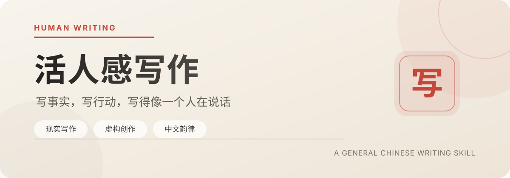

<p align="center">
  
</p>

<p align="center">
  <a href="README.md">繁體中文</a> ·
  <a href="README.en.md"><strong>English</strong></a>
</p>

<p align="center">
  <a href="https://github.com/SanHsien/human-writing/actions/workflows/ci.yml"></a>
  <a href="https://github.com/KKKKhazix/human-writing/releases/tag/v1.2.0"></a>
  <a href="./LICENSE"></a>
  <a href="https://github.com/KKKKhazix/human-writing/releases/latest"></a>
</p>

<p align="center">
  <a href="#quick-install">Install</a> ·
  <a href="#what-it-does">Writing flow</a> ·
  <a href="#repository-layout">Layout</a> ·
  <a href="#development">Development</a> ·
  <a href="https://github.com/KKKKhazix/human-writing/issues">Product issues</a>
</p>

> **This is a Windows-first maintenance fork of [`KKKKhazix/human-writing`](https://github.com/KKKKhazix/human-writing).** It keeps the MIT License and full git history. Product behaviour follows upstream; this line adds Traditional Chinese docs, a Windows development gate, and commit-by-commit upstream review. See [`FORK.md`](FORK.md) and [`docs/UPSTREAM.md`](docs/UPSTREAM.md).

> AI-written Chinese often sounds fluent, yet you cannot tell who wrote it. Human Writing exists to fix that.

The skill makes model output read like a specific person talking: someone who knows some things, has a judgment, can digress for a sentence, and still find the way back. It covers Zhihu answers, WeChat / blog essays, forum posts, profiles, popular science, reviews, fiction, and spoken scripts.

## What it does

Before writing, it asks a harder question: do you actually have material?

For nonfiction, missing facts must be researched, asked about, or cut. Padding with circular explanation is not allowed. Fiction may invent people and plots, but every scene still needs a goal, an action, and a change.

After the material gate, it watches three things:

| Material | Movement | Chinese |
| :--- | :--- | :--- |
| Nonfiction verifies facts, numbers, quotes, and lived experience. Fiction checks character, action, and cause. | Every paragraph must add something new. Repeating a finished point does not count. | Plain speech first. Watch word order and pauses. Strip report-speak, model-speak, and reversal rhetoric. |

A finished draft still has to pass revision. The skill checks whether paragraphs are spinning in place, cuts repeated explanations, varies sentence length, and blocks overused colons, dashes, `not A but B` reversals, and common AI jargon. The checker only enforces rules that are already written down. It does not choose a style for you.

## Quick install

Send this to your agent:

```text
Install this skill: https://github.com/SanHsien/human-writing
```

The agent will read the repository and install the `human-writing` folder. The display name is 「活人感寫作」. To install upstream directly, use `https://github.com/KKKKhazix/human-writing`.

Claude Code can also install from the marketplace:

```text
/plugin marketplace add KKKKhazix/human-writing
/plugin install human-writing@human-writing
```

<details>
<summary><strong>Manual install</strong></summary>

Download the upstream [release](https://github.com/KKKKhazix/human-writing/releases/latest), or copy the [`human-writing`](./human-writing) folder into your local skills directory. Keep the folder name `human-writing`.

```text
Claude Code   ~/.claude/skills/human-writing/
Codex         ~/.agents/skills/human-writing/
```

Other tools can use their respective skill directories.

</details>

Then ask normally:

```text
Use human-writing to turn my material into a piece with human texture and Chinese rhythm.
```

If the chat UI cannot install skills, use the [distilled version](./human-writing/dist/human-writing-lite.md).

## What 1.2.0 changed

This release addresses community feedback and merges PRs from Shann5, qshanx, and TZPlus:

- Clarified fiction revision: only redundant emotional explanation after actions is pruned; psychological and facial details that action cannot convey are preserved.
- The prose checker catches template openers (`在当今……时代`), rallying endings (`让我们……吧`), and `不仅仅是……而是……`. False positives on `10:30` colons, Markdown table alignment colons, and dialogue quotes are eliminated.
- The skill description was condensed to roughly 200 characters, explicitly excluding official documents, contracts, technical documentation, code, and translation.
- Upstream README was rewritten following its own rules.

See [CHANGELOG.md](./CHANGELOG.md) for the full list.

## Repository layout

<details>
<summary><strong>Show the skill tree</strong></summary>

```text
human-writing/
├── SKILL.md
├── VERSION
├── LICENSE
├── agents/
│   └── openai.yaml
├── dist/
│   └── human-writing-lite.md
├── references/
│   ├── forum-prose.md
│   ├── reality.md
│   ├── fiction.md
│   ├── formats.md
│   └── revision.md
└── scripts/
    └── check_prose.py
tests/
.claude-plugin/
└── marketplace.json
```

| Location | Purpose |
| :--- | :--- |
| [`SKILL.md`](./human-writing/SKILL.md) | Entry point: material threshold, nonfiction vs. fiction rules, and revision checklist |
| [`forum-prose.md`](./human-writing/references/forum-prose.md) | Zhihu, WeChat, and forum rhythm and phrasing |
| [`reality.md`](./human-writing/references/reality.md) | Factual boundaries for real people, history, news, and personal experience |
| [`fiction.md`](./human-writing/references/fiction.md) | Fiction, stories, narrative prose, and dialogue |
| [`formats.md`](./human-writing/references/formats.md) | Short content, podcasts, speeches, tutorials, and reviews |
| [`revision.md`](./human-writing/references/revision.md) | Multi-pass revision procedure |
| [`check_prose.py`](./human-writing/scripts/check_prose.py) | Prose checker script for hard constraints |
| [`human-writing-lite.md`](./human-writing/dist/human-writing-lite.md) | Distilled prompt for direct chat window paste |
| [`tests/`](./tests) | Regression tests for the checker and skill package |

</details>

The product files stay in upstream Simplified Chinese. This fork adds [`AGENTS.md`](AGENTS.md), [`FORK.md`](FORK.md), and [`docs/DEVELOPMENT.md`](docs/DEVELOPMENT.md).

## Development

Windows 11 + PowerShell is the primary development and acceptance environment.

```powershell
python -m venv .venv
.venv\Scripts\python -m pip install --upgrade pip
.venv\Scripts\python -m pip install -r requirements-dev.txt
pwsh -NoProfile -File tools\dev_check.ps1
```

Run tests after changing the checker. On Windows run `pwsh -NoProfile -File tools\dev_check.ps1`; on Linux run `python -m pytest tests -q`.

CI runs these tests and verifies README prose compliance on every PR.

Details: [`docs/DEVELOPMENT.md`](docs/DEVELOPMENT.md). Upstream sync: [`docs/UPSTREAM.md`](docs/UPSTREAM.md).

## Feedback

MIT licensed. Product rules and tools are inherited from the upstream author's MIT-licensed work; this fork does not bundle third-party articles, training corpora, or model weights.

For product rules, false positives, or model behaviour, report the issue to [upstream](https://github.com/KKKKhazix/human-writing/issues). For Windows maintenance, CI, or fork-documentation changes, open a pull request against this fork with reproducible context.

<p align="center">
  <sub>Human Writing · 1.2.0 · SanHsien maintenance fork</sub>
</p>
